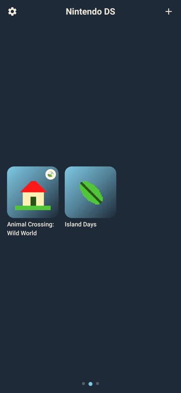
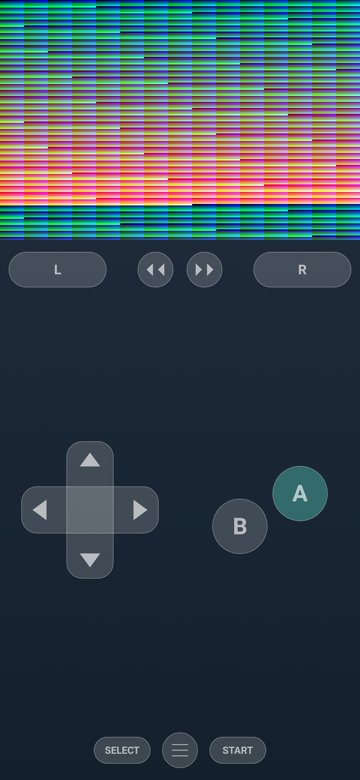
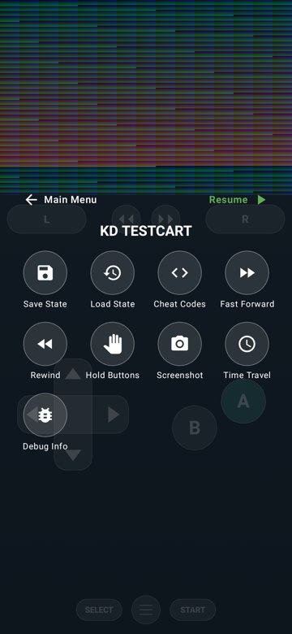
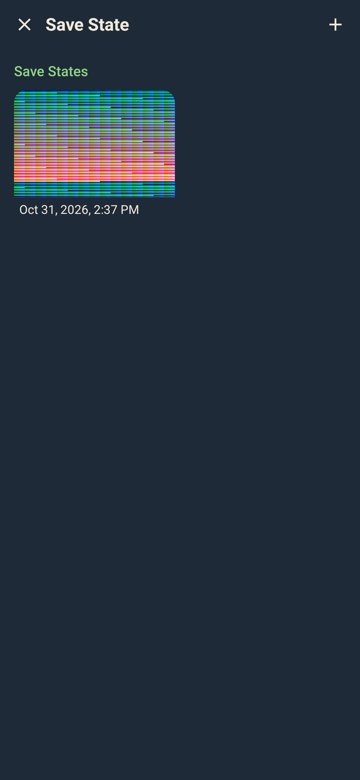

# KD-Emulator

An Android emulator for Game Boy Advance and Nintendo DS, tuned for Google Tensor phones (G1–G5).
It has a Rust core and a Kotlin / Jetpack Compose app modelled on Delta:
- an artwork library with one page per console;
- controller skins (including imported `.deltaskin` files);
- save states with screenshots, rewind, fast-forward and cheats;
- auto-resume.

**Download:** the APK is on the [Releases](../../releases) page.

<p>




</p>

The screenshots come from the app's JVM UI tests running synthetic test cartridges.

Both systems have an **Animal Crossing profile**. When it recognises an Animal Crossing game code, the emulator sets
the console up the way that game expects:

- **Game Boy Advance:** link-cable (JoyBus) mode; multiboot images (`.mb`) boot straight into RAM.
- **Nintendo DS** (*Wild World*): stylus-first controls, a time-travel clock and a 256 KB Flash save.

Time travel changes only the game's clock, never your phone's. The offset is remembered per game.

## Building

```sh
cargo test --workspace                       # host tests, no device needed
cd android && ./gradlew assembleDebug        # APK; builds libkd_emulator.so via cargo-ndk
cd android && ./gradlew testDebugUnitTest    # UI tests (Robolectric + host build of the native library)
```

The APK build needs the Android SDK (platform 35), NDK r28, `rustup target add aarch64-linux-android` and
`cargo install cargo-ndk`. The app targets arm64-v8a, Android 12+ (minSdk 31). Its native library is linked for
16 KB pages.

[CLAUDE.md](CLAUDE.md) covers the architecture, memory maps and the Tensor thermal rules. [STATUS.md](STATUS.md) lists what works and what's missing.

## Games and firmware

No BIOS, firmware, keys or game data are included or needed: the GBA and DS BIOS and the DS firmware are
emulated at a high level. Use dumps of games you own.
Animal Crossing is a trademark of Nintendo. This project isn't affiliated with or endorsed by Nintendo, and its
"Island" theme and icon are original artwork.
